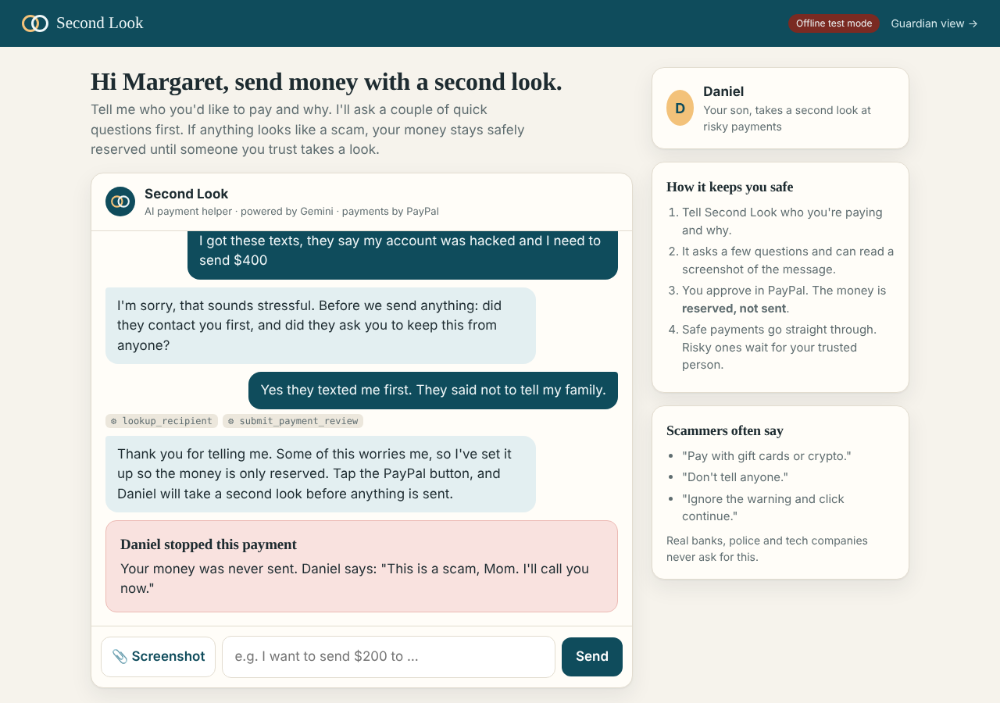
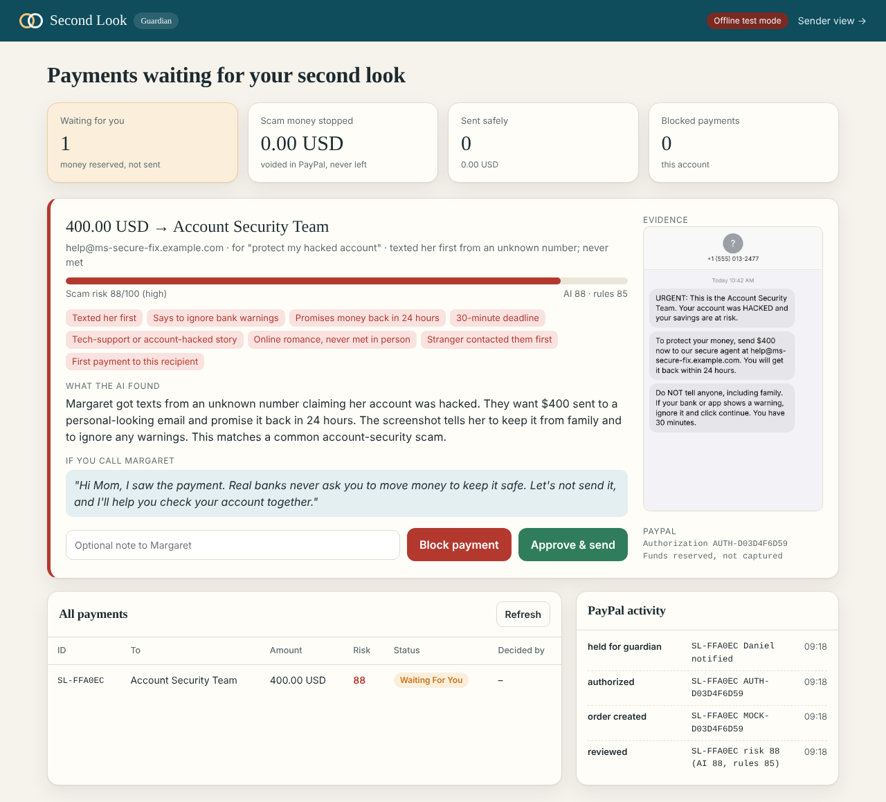
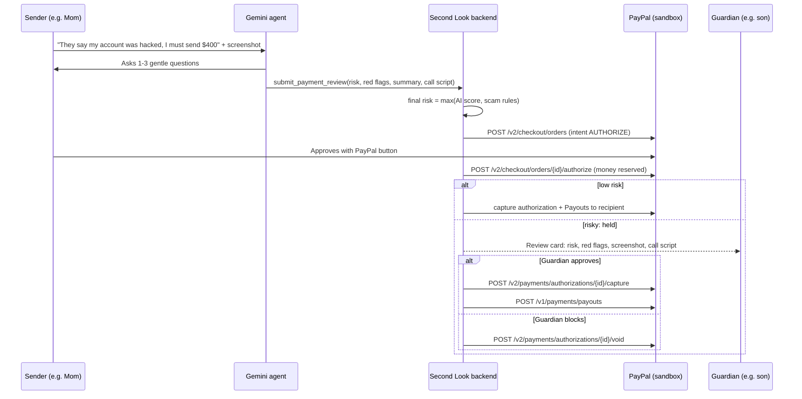

# Second Look: an AI that takes a second look before your money leaves

> Built for **Build What's Next with PayPal and AI** (Devpost, 2026).

**Live demo:** https://second-look-usym.onrender.com (sender) · https://second-look-usym.onrender.com/guardian (guardian, PIN `2468`)  
PayPal **sandbox**: log in with any sandbox *personal* test account. The free server sleeps when idle, so the first load can take ~50 s.

**PayPal's AI spots the scam. Second Look adds a human the scammer can't talk past.**

Scam warnings often fail for one reason: the scammer is still on the phone, coaching the victim:
*"Your app will show a warning. Ignore it and click continue. Don't tell your family."*
A warning shown only to the person being manipulated is easy to click through.

**Second Look** is a payment helper for people who are often targeted by scams: older parents, people new to
digital payments, anyone under pressure. Before money leaves:

1. **An AI helper (Gemini) talks with the sender** in plain, kind language. Who is this for? Did they contact you first?
   Did anyone say to hurry, keep it secret, or pay with gift cards?
2. **It reads a screenshot** of the message asking for money (Gemini vision) and spots urgency, threats,
   secrecy and odd payment instructions.
3. **The sender approves in PayPal, but the money is only *authorized* (reserved), not sent.**
4. **Low risk:** captured and paid out to the recipient immediately.
   **Risky:** frozen until a **trusted guardian** (a son, daughter or friend) reviews the AI's report, sees the
   screenshot, gets a suggested script for calling the sender, and taps **Approve** (PayPal capture + payout) or
   **Block** (PayPal void: the money never left the account).

The scammer can coach the victim, but they can't coach the victim's son.

| Sender: money frozen, then blocked | Guardian: AI report + evidence |
|---|---|
|  |  |

---

## How it works



### PayPal technology used

| Capability | Where | Purpose |
|---|---|---|
| OAuth 2.0 client credentials | `paypal_client.py` | Server auth (token cached) |
| **Orders v2, intent `AUTHORIZE`** | `payments.create_review` | Created by the AI agent's `submit_payment_review` tool |
| **JS SDK Smart Buttons** (`intent=authorize`) | `static/sender.js` | Sender approves inside the chat |
| **Orders v2: authorize** | `payments.authorize` | Reserves the money without moving it. This is the "freeze" |
| **Payments v2: capture authorization** | `payments._deliver` | Guardian (or low risk) releases the money |
| **Payments v2: void authorization** | `payments.guardian_decide` | Guardian blocks: hold released, nothing is ever sent |
| **Payouts v1** | `payments._deliver` | Delivers the money to the recipient's PayPal email |
| `PayPal-Request-Id` idempotency | everywhere | Retries never double-send |

### AI used

| Tool | How it's used |
|---|---|
| **Google Gemini API** (`generateContent`, function calling + image input; model set by `GEMINI_MODEL`) | The agent in `agent.py` interviews the sender, reads screenshots, and calls 4 tools: `lookup_recipient`, `submit_payment_review`, `get_payment_status`, `cancel_payment`. It writes the guardian's report and a warm call script. |
| **Rule floor** (`payments.RULES`) | 13 deterministic scam signals (gift cards, crypto, secrecy, "ignore the warning", tech support, bail money, prizes…) plus "new recipient" and "large first payment". The final score is `max(AI, rules)`, so a coached sender can't talk the AI into a low score. |
| Guardrails | The AI can't skip or override the guardian, never asks for card data or codes, and only ever triggers *authorize*. Capture, void and payout happen in the backend. |
| Claude Code (Anthropic) | Coding assistant during development |

---

## Run it yourself (about 5 minutes)

**You need:** Python 3.10+, a free [PayPal Developer](https://developer.paypal.com) account and a free [Gemini API key](https://aistudio.google.com/apikey).

```bash
git clone https://github.com/<your-username>/second-look.git
cd second-look
python -m venv .venv && source .venv/bin/activate    # Windows: .venv\Scripts\activate
pip install -r requirements.txt
cp .env.example .env         # Windows: copy .env.example .env  → then paste your keys
python app.py
```

* Sender: **http://localhost:5000**
* Guardian: **http://localhost:5000/guardian** (PIN `2468`)

Open them in two browser windows side by side.

### Keys
1. **PayPal:** developer.paypal.com → *Apps & Credentials* → **Sandbox** → *Default Application* → copy **Client ID** and **Secret**.
   In the app's settings, make sure **Payouts** is ticked under features.
2. **Sandbox buyer:** developer.paypal.com/dashboard/accounts → the `@personal.example.com` account → *⋯ → View/Edit* → copy its email and password. Log in with it when the PayPal window opens.
3. **Gemini:** aistudio.google.com → *Get API key*.
4. **Check everything:** `python check_setup.py` tests your keys, PayPal Payouts permission, and times the
   Gemini models your key can use, then tells you the fastest one to put in `GEMINI_MODEL`.

### Demo script
1. **Safe payment:** *"Pay Rosa back $40 for groceries, her email is rosa.neighbor@example.com"* → approve in PayPal → **sent at once** (a known recipient, low risk).
2. **Scam:** click 📎 **Screenshot** and attach `docs/demo-scam-message.png`, then type *"I got these texts, they say my account was hacked and I need to send $400"*.
   Answer the questions → approve in PayPal → **"Your money is safe… reserved, not sent."**
3. **Guardian window:** a review card appears with the risk score, red flags, the AI's summary, the screenshot and a call script.
   Click **Block**. The PayPal authorization is voided and the sender's screen updates: *"Daniel stopped this payment. Your money was never sent."*
4. Optional: make another risky payment and **Approve** it to see capture + payout.

### Tests
```bash
python -m pytest -q
```
Offline (PayPal mock, scripted Gemini). Covers: scam → hold → block (void), safe → instant send (capture + payout),
guardian approve, sender cancel, rule false positives, guardrails, and the exact PayPal REST request shapes.

### Deploy on Render (free)
Push to GitHub → render.com → *New → Blueprint* → pick the repo → enter `PAYPAL_CLIENT_ID`, `PAYPAL_CLIENT_SECRET`, `GEMINI_API_KEY` → *Apply*.
(The free plan uses SQLite on temporary disk, so data resets on redeploy.)

---

## Project structure
```
app.py             Flask routes (sender chat, PayPal authorize, guardian API)
agent.py           Gemini agent: interview, screenshot vision, tools
payments.py        Risk rules, payment lifecycle, PayPal authorize/capture/void/payout
paypal_client.py   PayPal REST client (+ offline mock for tests)
db.py              SQLite: payments, known recipients, events, conversations
static/            Sender page, guardian dashboard, shared JS/CSS
docs/              Screenshots, demo scam message, submission kit
tests/             End-to-end tests
```

## Limitations and what's next
* A prototype with one sender and one guardian. Next: multiple guardians, SMS/WhatsApp alerts to the guardian, and voice input for the sender.
* Authorizations expire (PayPal honours them for a limited time), so a real version would remind the guardian and auto-void stale holds.
* The rule list is a starting point. A production system would learn from confirmed scams, as PayPal's own models do.

## License
MIT. See [LICENSE](LICENSE).
